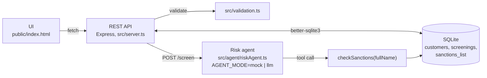

# mini-kyc-qa

[](https://github.com/afreennaseem/mini-kyc-qa/actions/workflows/ci.yml)

A portfolio project: a QA framework for a small compliance (KYC) onboarding app. Customers submit a form, the
API validates and stores them in SQLite, and a risk agent screens them against a sanctions list, PEP status and
high-risk countries. The app is deliberately small; the point is the test suite around it: UI, API + database,
regression, and evals for the AI agent, all wired into CI. Requirements are in
[docs/acceptance-criteria.md](docs/acceptance-criteria.md) (AC-01 to AC-11) and every test is tagged with the AC it covers.

## Architecture



Screening maps risk to status: low → approved, medium → review, high → rejected.
`mock` mode applies the rules in code (free, deterministic); `llm` mode sends a system prompt and the tool
definition to the Claude API. Full spec: [docs/SPEC.md](docs/SPEC.md).

```
src/            server.ts, db.ts, validation.ts, agent/riskAgent.ts
public/         index.html
specs/          onboarding.md (Planner output, reviewed)
tests/
  seed.spec.ts  seed test used by the Playwright agents
  e2e/          onboarding.spec.ts (Generator output, refactored to a page object)
  api/          customers.api.spec.ts (API + DB checks)
  regression/   nordic-names.spec.ts (BUG-001)
  support/      apiClient.ts, db.ts, factories.ts, fixtures.ts, pages/OnboardingPage.ts
evals/          dataset.json, riskAgent.eval.spec.ts, evals.setup.ts, support/
docs/           SPEC.md, acceptance-criteria.md, evals-notes.md, bugs/, images/
.github/workflows/ci.yml
```

## Quick start

Requires Node 25.

```bash
npm ci
npx playwright install chromium
npm start                 # http://localhost:3000, AGENT_MODE=mock by default
```

| Script | Runs |
| --- | --- |
| `npm run typecheck` | `tsc --noEmit` |
| `npm test` | all Playwright projects |
| `npm run test:e2e` | UI tests (Chromium) |
| `npm run test:api` | API + database tests |
| `npm run test:regression` | regression tests (API and UI) |
| `npm run test:evals` | agent evals; set `AGENT_MODE=llm` and `ANTHROPIC_API_KEY` for the real model |

Playwright starts the server itself with `AGENT_MODE=mock` and a separate `test.db`, so tests never touch `kyc.db`.

## Test strategy

| Layer | What it proves | Location | Tests |
| --- | --- | --- | --- |
| E2E (UI) | A user can onboard and screen through the form; errors appear next to fields (AC-01/02/03/06/07/09) | `tests/e2e/`, `tests/seed.spec.ts` | 6 (5 + seed) |
| API + DB | Status codes, field errors, stored rows, risk → status mapping, screenings ordering (AC-01 to AC-10) | `tests/api/` | 10 |
| Regression | BUG-001 stays fixed: international names accepted and stored exactly, invalid names still rejected (AC-11) | `tests/regression/` | 13 |
| Agent evals | Agent output is valid, grounded and correct on critical cases; overall accuracy ≥ 90% | `evals/` | 13 + 1 setup |

UI tests assert what the user sees; anything not shown in the UI (customer status, stored rows) is checked
through the API or the database directly. The traceability matrix is at the end of the acceptance criteria.

## AI-assisted testing

The Playwright test agents were used for the UI layer, with a human review step after each one:

- **Planner** explored the running app from `tests/seed.spec.ts` and wrote [specs/onboarding.md](specs/onboarding.md).
  I reviewed the plan against the acceptance criteria before generating anything: each scenario carries its AC IDs,
  and the plan records that customer status is not shown in the UI, so tests verify it through the API.
- **Generator** turned the plan into tests. I refactored the output into a page object
  (`tests/support/pages/OnboardingPage.ts`) and fixtures instead of keeping repeated raw locators.
- **Healer** was run after the submit button was renamed from "Submit" to "Send Application". Its fix was a
  one-line locator change in the page object. I read the diff and checked the rename was intentional (the spec
  was updated in the same commit) before accepting it, since a healer that "fixes" a test can also hide a real bug.

API, regression and eval tests were written by hand.

## Agent evals

`evals/dataset.json` holds 12 labelled cases (low, PEP, high-risk country, sanctions match, plus a near-miss name).
Each case is checked at three levels:

1. **Hard invariants** (every case): output matches the JSON schema, `sanctionsHit` matches the tool result
   (never missed, never invented), the grounding guard did not fire, and every reason cites a real input field.
2. **Critical cases** (H1–H4: sanctions matches and high-risk countries): risk must be exactly right.
   On other cases a wrong risk is only recorded as an annotation.
3. **Accuracy gate**: overall risk accuracy must be ≥ 0.9.

Mutation check ([docs/evals-notes.md](docs/evals-notes.md)): removing the guard that lets PEP status only raise
*low* risk made H3 (a PEP in Iran) come back as medium. Accuracy was still 11/12 = 91.7%, above the threshold, so
the accuracy gate alone would have passed. The critical-case check failed it. That is why both levels exist.

## Regression story: BUG-001

[docs/bugs/BUG-001-nordic-names.md](docs/bugs/BUG-001-nordic-names.md): the name pattern `/^[A-Za-z ]+$/`
rejected names like "Søren Ægidius" and "Ana-Maria O’Neil" with a 400.

- **Compliance impact:** Danish, Swedish and Norwegian customers could not onboard, and any hyphenated or
  apostrophe name was blocked, including 2 of the 5 sanctions-list names. Those people could never reach
  sanctions screening through the normal flow, so the bug hid sanctions hits rather than causing them.
- **Red:** `tests/regression/nordic-names.spec.ts` was committed first and failed (`5929e4e`).
- **Green:** the pattern became `/^\p{L}[\p{L}\p{M} '’\-]*$/u` (`61830ea`). The same file also checks that
  digits, markup, underscores and blank names are still rejected, and that a hyphenated sanctions-list name now
  reaches screening and is rejected.

## CI pipeline

[.github/workflows/ci.yml](.github/workflows/ci.yml) runs on pushes to `main`, pull requests and manual dispatch.

- **typecheck** runs first; nothing else starts if it fails.
- **test** is a matrix over `e2e`, `api`, `regression`, `evals` with `fail-fast: false`, so one failing layer
  does not cancel the others and the PR shows exactly which layer broke. Chromium is installed only for the
  layers that need a browser. Each job uploads its Playwright report (`report-<project>`, 14 days).
- **llm-evals** runs only on manual dispatch with `llm_evals` ticked. It uses `AGENT_MODE=llm`, fails with a
  clear error if the `ANTHROPIC_API_KEY` secret is missing, and uploads `evals/results.json`.

**PR demo:** a branch that reintroduced the old name pattern failed only `test (regression)`; typecheck, e2e,
api and evals all passed. The e2e and API suites use plain ASCII names, so without the regression layer the
bug would have merged.

## Screenshots

CI on `main`: typecheck, then the four-layer matrix; `llm-evals` skipped.


The BUG-001 demo PR: only the regression check fails.


The regression report locally with the bug reintroduced.


The app after screening a sanctions-list name.


## Limitations and next steps

Current limitations:

- **Real-model evals not yet run.** `llm` mode and the `llm-evals` CI job are implemented, but every eval result
  so far is from `mock` mode. No API access yet.
- **Exact-match sanctions screening.** `checkSanctions` matches full names exactly. Transliterations, typos,
  reordered names and aliases would not match.
- **No transaction around screening.** Inserting the screening and updating the customer status are separate
  writes; a failure between them can leave a screening stored without the matching status.

Next steps:

- Prompt-injection evals (instructions hidden in name or email fields).
- OpenAPI contract tests for the REST API.
- Track eval accuracy per model version over time, not just pass/fail per run.
